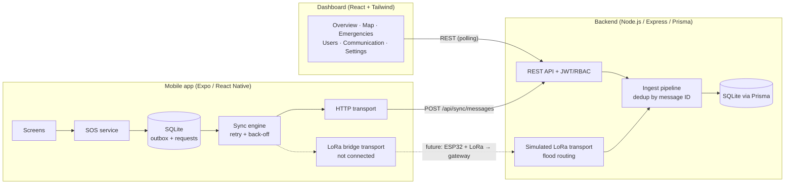

# RescueMesh — Intelligent Disaster Emergency Communication Network

RescueMesh lets people affected by a disaster send **SOS requests with their GPS location**, and lets emergency
responders **monitor, accept and resolve** those requests — even when normal communication infrastructure is
degraded.

| Part | What it is |
|---|---|
| **Mobile app** (`mobile/`) | React Native + Expo app for citizens (SOS) and responders (incoming emergencies). Offline-first: every SOS is stored in SQLite first and synchronised automatically when connectivity returns. |
| **Web dashboard** (`dashboard/`) | React emergency-operations dashboard: statistics, live map, emergency management, users, communication monitoring, settings. |
| **Backend** (`backend/`) | Node.js + Express + TypeScript REST API with Prisma (SQLite), JWT auth, role-based access, idempotent offline-sync endpoint and a **simulated** LoRa mesh. |
| **Docs** (`docs/`) | Architecture, database ER diagram, communication flow, API reference, LoRa integration, demo guide. |

> **What is real and what is simulated.** Online communication (REST API) and offline storage + automatic
> synchronisation on the phone are fully implemented and tested. The ESP32 + LoRa radio network is **simulated in
> software** on the backend (flood routing, hop counts, duplicate suppression, store-and-forward). No LoRa hardware
> has been connected or tested; the code contains a transport interface and documented packet format for it. The
> dashboard labels every piece of simulated data as **Simulated**.

---

## 1. System architecture



More diagrams: [docs/ARCHITECTURE.md](docs/ARCHITECTURE.md) · [docs/DATABASE.md](docs/DATABASE.md) ·
[docs/API.md](docs/API.md) · [docs/LORA_INTEGRATION.md](docs/LORA_INTEGRATION.md) · [docs/DEMO_GUIDE.md](docs/DEMO_GUIDE.md)

## 2. Technology stack

| Layer | Technologies |
|---|---|
| Mobile | React Native 0.88, Expo SDK 58, TypeScript, React Navigation 7 (native stack + bottom tabs), expo-location, expo-sqlite (+ kv-store), expo-crypto, NetInfo, React Context for state |
| Dashboard | React 18, TypeScript, Vite 5, Tailwind CSS 3, Recharts, Leaflet + react-leaflet (OpenStreetMap tiles), React Router, lucide-react icons |
| Backend | Node.js 20+, Express 4, TypeScript, Prisma 6 ORM, SQLite, zod validation, bcrypt password hashing, JSON Web Tokens |
| Testing | node:test + supertest (API), node:test (mobile sync engine), integration script against the live API |

## 3. Project structure

```
RescueMesh/
├── backend/
│   ├── prisma/            schema.prisma, seed.ts (demo data)
│   ├── scripts/           setup-env.ts, test-db.ts, check-topology.ts
│   ├── src/
│   │   ├── domain/        enums, status transitions, default priorities
│   │   ├── mesh/          packet format, pure flood simulator, transports (simulated + serial stub)
│   │   ├── middleware/    JWT auth + role guard
│   │   ├── routes/        auth, users, emergencies, sync, comm, stats, settings
│   │   ├── services/      ingest (dedup), emergency status logic, settings
│   │   ├── app.ts         Express app      server.ts  entry point
│   └── tests/             api.test.ts, mesh.test.ts
├── dashboard/
│   └── src/
│       ├── api/           fetch client      context/  auth + settings
│       ├── components/    Layout, EmergencyMap, EmergencyDrawer, UI kit
│       ├── hooks/         usePolling       lib/      labels + colours
│       └── pages/         Login, Overview, LiveMap, Emergencies, Users, Communication, Settings
├── mobile/
│   ├── App.tsx
│   ├── src/
│   │   ├── components/    UI kit, RequestCard
│   │   ├── context/       AuthContext, SyncContext (connectivity + auto-sync)
│   │   ├── mesh/          packet format (mirror of backend)
│   │   ├── navigation/    RootNavigator, route types
│   │   ├── screens/       auth/, victim/, responder/, shared/
│   │   ├── services/      api, location, sos
│   │   ├── storage/       SQLite database (outbox, requests), kv settings
│   │   ├── sync/          syncEngine.ts (pure, unit-tested)
│   │   └── transports/    HttpTransport, LoRaBridgeTransport (not connected)
│   └── tests/             sync engine unit tests + live integration test
├── docs/
├── legacy/                earlier browser-only mesh simulator prototype (not used)
└── package.json           root scripts
```

## 4. Installation

Prerequisites: **Node.js 20 or newer** (tested with Node 24) and npm. For the phone: the **Expo Go** app (Android or
iOS) on a phone connected to the **same Wi-Fi network** as the computer.

```bash
cd RescueMesh
npm run setup
```

`npm run setup` installs all three apps, creates `backend/.env` with a random JWT secret, creates the SQLite
database and loads the demo data.

### Environment variables (`backend/.env`)

| Variable | Default | Purpose |
|---|---|---|
| `PORT` | `4000` | API port |
| `DATABASE_URL` | `file:./dev.db` | Prisma connection string (SQLite file in `backend/prisma/`) |
| `JWT_SECRET` | random (generated) | Secret for signing tokens — never commit it |
| `JWT_EXPIRES_IN` | `30d` | Token lifetime (long, so a signed-in phone can raise SOS offline for weeks) |
| `CORS_ORIGIN` | `*` | Allowed browser origins (comma-separated) |

Optional: `dashboard` reads `VITE_API_URL` (default: same origin through the Vite proxy); `mobile` reads
`EXPO_PUBLIC_API_URL` (default: your computer's LAN address detected from Expo, port 4000).

### Database

- Development uses **SQLite** (`backend/prisma/dev.db`), no server needed.
- `npm --prefix backend run db:seed` — wipe and reload demo data.
- `npm --prefix backend run db:push` — apply schema changes.
- **PostgreSQL:** set `provider = "postgresql"` in `backend/prisma/schema.prisma`, point `DATABASE_URL` at your
  database and run `npm --prefix backend run db:push && npm --prefix backend run db:seed`. Enumerations are stored as
  validated strings, so no schema rewrite is required.

## 5. Running

```bash
# Terminal 1 — backend API (http://localhost:4000) + dashboard (http://localhost:5173)
npm run dev

# Terminal 2 — mobile app
npm run mobile
```

- When the backend starts it prints **"On your network (use this in the mobile app): http://192.168.x.x:4000"**.
- Scan the QR code from the Expo terminal with Expo Go. The app guesses the server address from Expo; if the login
  screen shows "Server unreachable", tap **Server: … (change)** and enter the address printed by the backend.
- Allow Node.js through the Windows firewall on private networks if the phone cannot connect.

Individually: `npm --prefix backend run dev`, `npm --prefix dashboard run dev`, `npm --prefix mobile start`.

## 6. Demo credentials (seed data only)

| Role | Email | Password | Use in |
|---|---|---|---|
| Administrator | `admin@rescuemesh.org` | `Admin@12345` | Dashboard |
| Responder | `responder@rescuemesh.org` | `Responder@123` | Dashboard and mobile (responder view) |
| Responder | `responder2@rescuemesh.org` | `Responder@123` | Dashboard and mobile |
| Citizen / victim | `victim@rescuemesh.org` | `Victim@1234` | Mobile (victim view) |
| Citizen / victim | `fatima@example.com`, `usman@example.com` | `Victim@1234` | Mobile |

These are demonstration accounts created by the seed script. Change or remove them before any real deployment.

## 7. Main features

**Mobile — citizen:** splash, login, registration, home (big SOS button, connection status, GPS status, pending
offline messages, recent requests), SOS (category, auto-priority with override, people count, description, GPS),
location sharing (share / open in maps / send update to responders), my requests, request details (delivery
timeline PENDING → QUEUED → SENT → DELIVERED, responder status, retry, cancel), profile, settings (server address,
offline-mode switch, outbox, communication channels).

**Mobile — responder:** incoming emergencies (active / assigned to me / all, priority-sorted, cached list when
offline), emergency details (victim location + navigation, category, priority, timestamps, timeline), accept, mark
in progress, mark resolved.

**Dashboard:** overview with live statistics and charts, live map with priority-coloured markers and popups,
emergency table with search / filters / sorting / detail drawer / status updates / assignment / archive, user
management (roles, activation), communication monitoring (API status, message counters, duplicates blocked, simulated
LoRa topology, node power toggles, test transmissions with hop-by-hop trace), settings (system configuration, profile,
password).

## 8. API overview

Full reference with request/response examples: [docs/API.md](docs/API.md).

| Method | Endpoint | Access |
|---|---|---|
| POST | `/api/auth/register` · `/api/auth/login` | public |
| GET | `/api/auth/me` · POST `/api/auth/change-password` | signed in |
| GET/POST | `/api/emergencies` | victims see their own; responders/admins see all |
| GET | `/api/emergencies/:id` | owner, responder, admin |
| PATCH | `/api/emergencies/:id/status` | responder/admin (victim: cancel own) |
| PATCH | `/api/emergencies/:id/assign` | responder (self) / admin (anyone) |
| DELETE | `/api/emergencies/:id` (`?hard=true`) | admin — archive / delete |
| POST | `/api/sync/messages` | signed in — idempotent offline outbox upload |
| GET | `/api/sync/messages` | responder/admin — message log |
| GET/PATCH | `/api/users`, `/api/users/:id` | admin manages; users edit own profile |
| GET | `/api/stats/overview` | responder/admin |
| GET/PATCH/POST | `/api/comm/status`, `/nodes`, `/nodes/:id`, `/simulate`, `/transmissions`, `/pending` | responder/admin (simulated mesh) |
| GET/PUT | `/api/settings` | read: signed in; write: admin |
| GET | `/api/health` | public |

## 9. Offline functionality

1. Pressing **SOS** generates a unique request ID and message ID on the phone (`expo-crypto` UUIDs).
2. The request and its outbox message are written to **SQLite in one transaction** before any network call — the SOS
   survives closing the app or restarting the phone.
3. The **sync engine** uploads the outbox whenever the server is reachable (on reconnect, every 10 s while online, and
   on demand). Failed attempts back off exponentially (5 s → 5 min). Status flow:
   `PENDING → QUEUED → SENT → DELIVERED`, or `FAILED` if the server rejects a message as invalid.
4. The server **de-duplicates by message ID** (and by request ID), so retries and crash-after-send never create
   duplicates. Requests created offline are marked `OFFLINE_SYNC` and keep the original device timestamp.
5. "Online" means the RescueMesh server answers `/api/health` — not merely that the phone has Wi-Fi.
6. **Settings → Simulate no connectivity** blocks all network use by the app, to demonstrate offline behaviour without
   touching the phone's radio settings. Airplane mode works too.

## 10. LoRa integration

See [docs/LORA_INTEGRATION.md](docs/LORA_INTEGRATION.md). In short:

- A standard **MeshPacket** (message ID, source/destination node, type, GPS, timestamp, priority, hop count, max hops,
  payload) is shared by the phone outbox and the mesh. A compact encoding fits one LoRa frame (≤ 222 bytes).
- The backend's `SimulatedLoRaTransport` demonstrates sending from a node, forwarding through relays, receiving at a
  gateway, **duplicate suppression** (per-node seen cache), **hop counting**, **loop prevention / max hops**, and
  **store-and-forward** when the mesh is partitioned.
- `SerialLoRaTransport` (backend) and `LoRaBridgeTransport` (mobile) are the hardware integration points. They report
  "not connected" and are never used for delivery until real ESP32 hardware is built and tested.

## 11. Testing

```bash
npm run typecheck          # backend, dashboard and mobile TypeScript checks
npm test                   # backend API + mesh tests (23) and mobile sync-engine tests (8)
npm run build              # backend compile + dashboard production build
npm run test:integration   # with the backend running: offline → restart → sync → duplicate → responder flow
```

The backend tests use a separate database (`backend/prisma/test.db`) and never touch the demo data.

What the automated tests cover: registration/login/JWT, role-based access, validation errors, SOS creation, offline
batch sync, duplicate prevention (same message ID and same request ID), location updates, status transitions and
history, cancel/archive, filtering/sorting/search, user management and deactivation, statistics, settings, multi-hop
forwarding, duplicate suppression in loops, hop limits, partitions and store-and-forward retry, compact encoding.

Not covered by automated tests (verify manually on a device, see the demo guide): the React Native screens
themselves, SQLite persistence on a real phone, GPS permission flows, and the dashboard's visual rendering.
