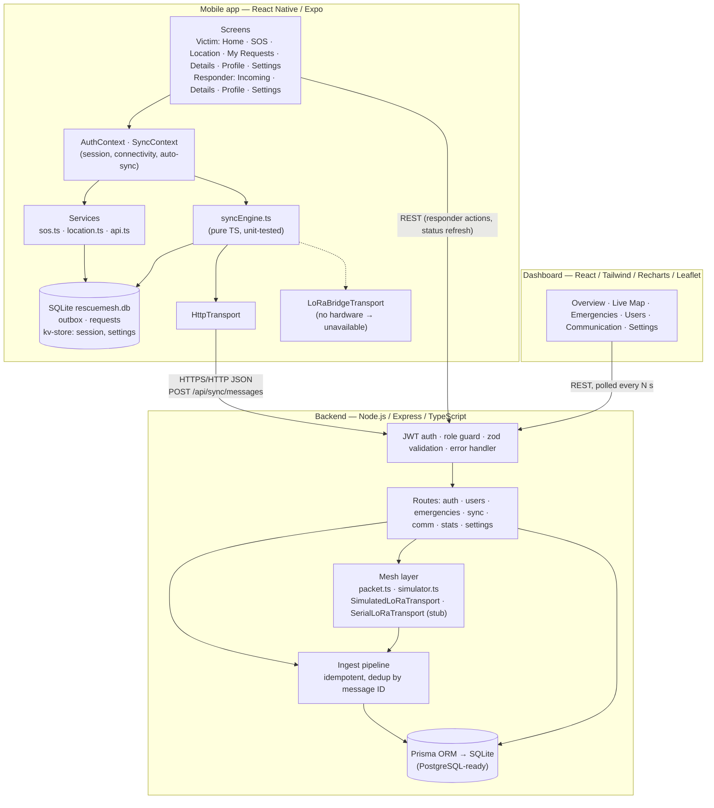
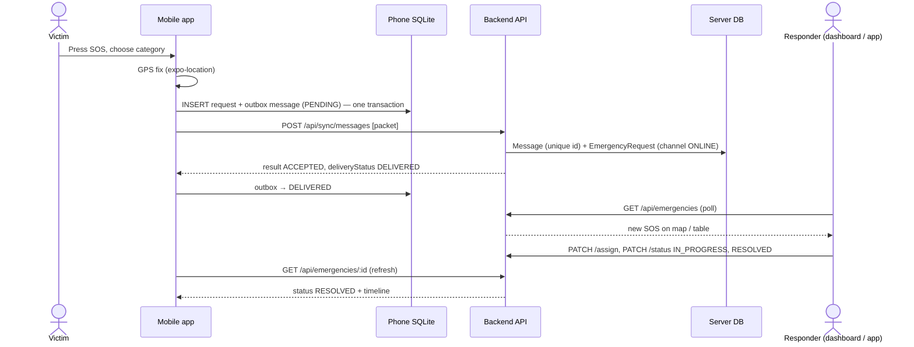
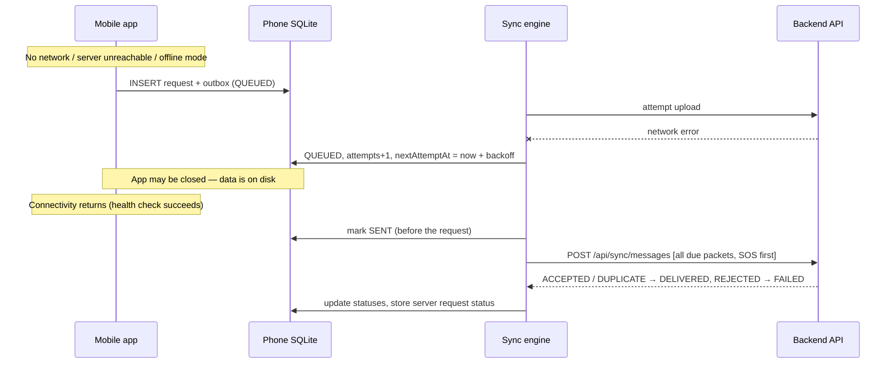
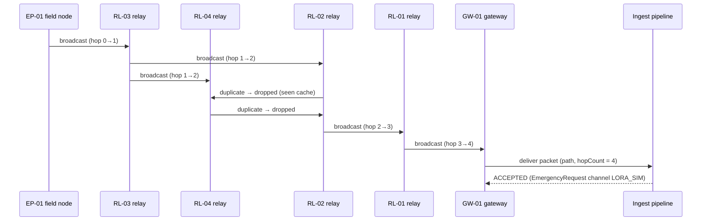

# RescueMesh — System Architecture

## 1. Components

### Design decisions

| Decision | Reason |
|---|---|
| Store-then-send on the phone | An SOS must never depend on the network being up at the moment the button is pressed. |
| Client-generated IDs (UUID v4) | Lets the server de-duplicate retries; the phone can reference the request before the server has seen it. |
| One ingest pipeline for HTTP and LoRa | Offline sync and mesh delivery share validation and de-duplication; a future hardware gateway plugs into the same path. |
| Pure sync engine and pure mesh simulator | Testable in Node without a phone or radios; UI is independent of communication logic. |
| Polling instead of WebSockets in the dashboard | Simpler and robust on weak networks; interval is configurable (Settings → Dashboard refresh). |
| Enumerations as validated strings | SQLite in development, PostgreSQL later, with no schema rewrite. |
| Simulated data always labelled | The dashboard shows a "Simulated" tag wherever node data comes from the simulator. |

## 2. Communication flows

### 2.1 Online SOS

### 2.2 Offline SOS with automatic synchronisation

If the app dies after the server stored a message but before the phone recorded the reply, the message stays `SENT`
and is uploaded again; the server answers `DUPLICATE` (treated as delivered) and stores nothing new.

### 2.3 Simulated LoRa multi-hop delivery

If no route exists (e.g. relay RL-05 powered off), the packet is stored in `PendingPacket` at the last node that holds
it and re-flooded automatically when any node's state changes (store-and-forward).

## 3. Security

- Passwords hashed with bcrypt (cost 10); never returned by the API.
- JWT (HS256) with a random 96-hex-character secret generated into `backend/.env` (git-ignored).
- Every request re-loads the user: deactivated accounts lose access immediately, even with a valid token.
- Role-based guards: public registration always creates `VICTIM`; only admins change roles; victims only see and
  cancel their own requests; users cannot change their own role or deactivate themselves.
- All input validated with zod; consistent error format `{ error: { message, details } }`.
- `.env`, databases and build output are git-ignored.
