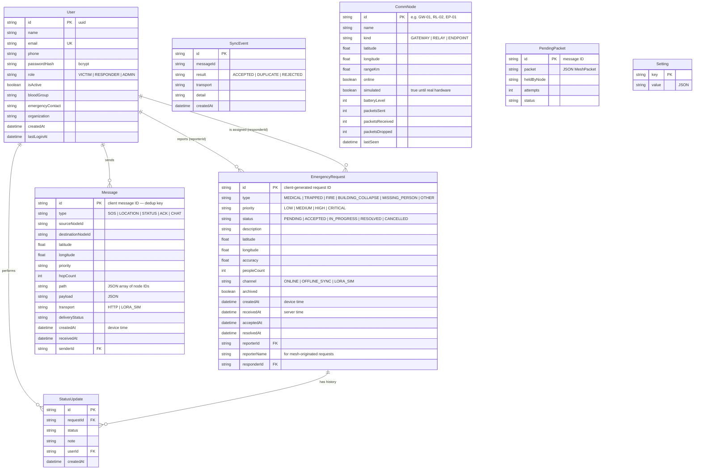
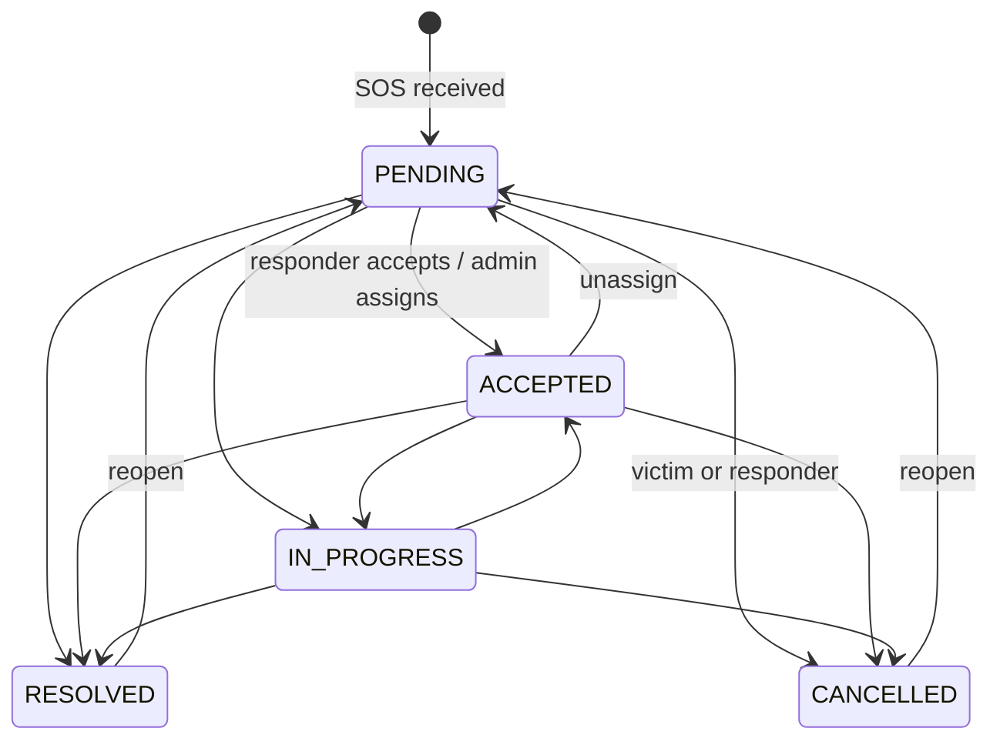
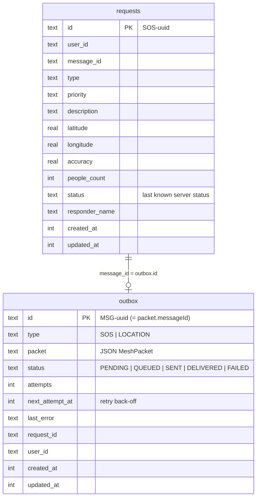

# RescueMesh — Database Design

Server database: Prisma ORM, SQLite in development (`backend/prisma/schema.prisma`). Enumerated values are stored as
strings and validated in `backend/src/domain/constants.ts`, so changing the provider to PostgreSQL requires no model
changes.

## Entity-relationship diagram (server)

`SyncEvent`, `CommNode`, `PendingPacket` and `Setting` are standalone tables (no foreign keys): `SyncEvent` is an audit
log of every ingest attempt (used for "duplicates blocked"), `CommNode`/`PendingPacket` hold the simulated mesh, and
`Setting` stores system configuration.

## Status transitions (EmergencyRequest)

Every change writes a `StatusUpdate` row (who, when, optional note) shown as the request timeline.

## Mobile local database (`rescuemesh.db` on the phone)

Session token, user profile, server address, offline-mode flag and the device node ID are stored in
`expo-sqlite/kv-store` (also SQLite-backed, persistent).
