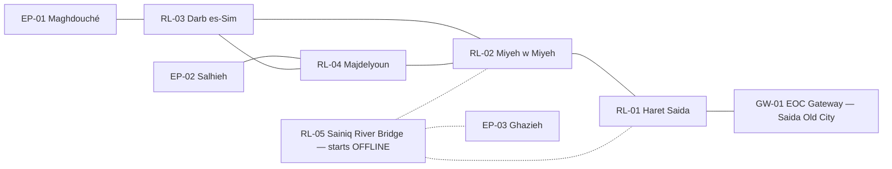

# ESP32 + LoRa Integration

## Status

| Item | State |
|---|---|
| Standard mesh packet format | **Implemented** (`backend/src/mesh/packet.ts`, mirrored in `mobile/src/mesh/packet.ts`) |
| Compact over-the-air encoding (≤ 222 bytes) | **Implemented and tested** (`encodeCompact` / `decodeCompact` / `fitToFrame`) |
| Flood routing: forwarding, hop count, duplicate suppression, max hops, store-and-forward | **Implemented in a software simulator and tested** (`simulator.ts`, `simulatedLoRaTransport.ts`) |
| Transport abstraction (backend `MeshTransport`, mobile `MessageTransport`) | **Implemented** |
| Physical radio communication | **Not implemented / not tested.** `SerialLoRaTransport` and `LoRaBridgeTransport` refuse to send and report "hardware not connected". |

Nothing in the system claims a physical LoRa transmission took place. All mesh data shown in the dashboard is tagged
**Simulated**.

## Packet format

| Field | Type | Description |
|---|---|---|
| `messageId` | string (8–64, `[A-Za-z0-9_-]`) | Globally unique; the de-duplication key everywhere |
| `sourceNodeId` | string | Originating node (e.g. `EP-01`, `PHONE-3F9A…`) |
| `destinationNodeId` | string | Target node, or `SERVER` = any gateway |
| `type` | `SOS` \| `LOCATION` \| `STATUS` \| `ACK` \| `CHAT` | Message type |
| `latitude`, `longitude` | number \| null | WGS-84 GPS position |
| `timestamp` | epoch ms | Creation time at origin |
| `priority` | `LOW` \| `MEDIUM` \| `HIGH` \| `CRITICAL` | SOS is forwarded first |
| `hopCount` | int | Incremented on every forward |
| `maxHops` | int | TTL: not forwarded once `hopCount >= maxHops` (system setting, default 6) |
| `payload` | object | Type-specific (SOS: `requestId, category, description, peopleCount, accuracy`) |

On air (compact JSON, one line per packet over serial):

```json
{"i":"m-3fa29c01b2d4","s":"EP-01","d":"SERVER","t":1,"la":3150500,"lo":7439500,"ts":1794939000,"p":3,"h":0,"m":6,
 "pl":{"r":"lora-7c1e5a90f3b2","c":"FIRE","x":"SOS from field node EP-01","n":1}}
```

`t` type code (SOS 1, LOCATION 2, STATUS 3, ACK 4, CHAT 5), `p` priority code (LOW 0 … CRITICAL 3), coordinates as
integers × 10⁵ (≈ 1 m), timestamp in seconds, abbreviated payload keys. `fitToFrame` shortens the description until
the packet fits in 222 bytes (no fragmentation is implemented).

## Routing rules (as simulated)

1. Two nodes are linked when both are online and their distance ≤ the smaller radio range.
2. A node that receives a packet checks its **seen cache** (message IDs). Already seen → drop (`DUPLICATE_DROPPED`).
   This prevents duplicate forwarding and infinite loops in cyclic topologies.
3. Otherwise it records the ID, and if it is the destination (or a `GATEWAY` for `SERVER`) it delivers; else, if
   `hopCount < maxHops`, it re-broadcasts with `hopCount + 1` (`HOP_LIMIT` otherwise).
4. If no node reaches the destination, the packet is held (`PendingPacket`) and re-flooded when topology changes.
5. A delivered packet goes to the same ingest pipeline as HTTP sync, so a message arriving by both paths is stored once.

## Demo topology (seed data) — Saida (Sidon), Lebanon

Fictional scenario: a flash flood along the Sainiq River, south-east of Saida. The operations-centre gateway is in
Saida's old city; relays step east and south-east into Haret Saida, Miyeh w Miyeh, Darb es-Sim and Majdelyoun; field
nodes are in the affected outlying areas. All points are inland (the sea is to the west). Defined in
`backend/prisma/demoScenario.ts` and verified by `backend/tests/scenario.test.ts`. All nodes are **simulated**.



Dotted links exist only while RL-05 is powered on.

- EP-01 → GW-01: 4 hops (EP-01 > RL-03 > RL-02 > RL-01 > GW-01), 2 duplicates dropped in the RL-02/RL-03/RL-04 triangle.
- EP-02 → GW-01: 4 hops via RL-04 (Majdelyoun).
- EP-03 has no route until RL-05 is powered on in the dashboard; its packet is then delivered in 3 hops (EP-03 > RL-05 > RL-01 > GW-01).
- No field node can reach the gateway directly, so every delivery is multi-hop.
- Default map centre: 33.547 N, 35.398 E, zoom 13 (the centre of the node network).
- Coordinates are approximate positions chosen for a coherent scenario, not surveyed sites. The radio ranges
  (2.5–3.0 km) are assumptions, not measurements.

Print the live topology at any time: `npx tsx backend/scripts/check-topology.ts` (read-only).

## Hardware integration plan


To connect real hardware:

1. **Firmware** (each node): keep a ring buffer of recently seen `i` values; on receive, drop if seen, else store,
   deliver if destination/gateway, else increment `h` and re-transmit after a short random delay (collision
   avoidance) when `h < m`.
2. **Gateway**: print every received packet as one line of compact JSON on USB serial; read lines from serial to
   transmit (for ACK / status messages back into the mesh).
3. **Backend**: implement `SerialLoRaTransport` with the `serialport` package — parse lines with `decodeCompact`, call
   `ingestPacket(packet, { transport: 'LORA', path })`, and select it in `src/mesh/simulatedLoRaTransport.ts`'s
   export. Add `'LORA'` to the transport values.
4. **Phone**: implement `LoRaBridgeTransport.isAvailable/postMessages` over BLE (requires a development build, not
   Expo Go). The sync engine already falls back to the first available transport.
5. Only after field testing should the dashboard's "Simulated" tags be removed for real nodes (`CommNode.simulated = false`).
